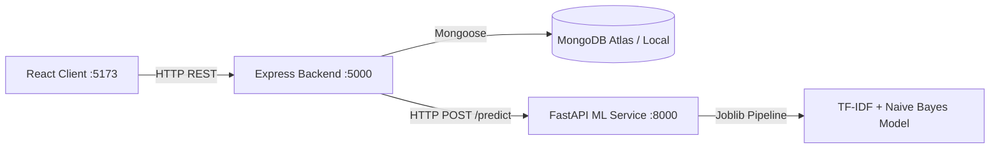

# DevAssist — Intelligent GitHub Issue Classification System

DevAssist is a full-stack, machine learning-powered web application that automatically classifies GitHub issue reports into three distinct categories:
1. **Bug** (defects, errors, regressions)
2. **Feature Request** (enhancements, new capabilities)
3. **Question** (support requests, usage inquiries)

---

## 1. Problem Statement
Maintaining open-source projects and enterprise repositories involves triaging hundreds of issue tickets. Manual labeling is time-consuming, prone to human inconsistency, and delays critical bug investigations. DevAssist leverages natural language processing (NLP) to inspect issue text, predict intent, quantify model confidence across classes, and store historical predictions for analysis.

---

## 2. Key Features
- **Supervised ML Classification**: TF-IDF (unigram + bigram) feature extraction paired with a Multinomial Naive Bayes classifier trained on GitHub issue data.
- **RESTful Architecture**: Node.js & Express API mediating validation, database persistence, and communication with the Python ML microservice.
- **Persistent Data Store**: MongoDB integration via Mongoose, storing predictions, raw inputs, model versions, and class probability vectors.
- **Responsive Dashboard**: React (Vite) interface styled in a developer-centric dark theme featuring category distribution analytics (Recharts), recent activity tracking, paginated history with live search/filters, and detailed issue inspection views.
- **Resilient Fault Handling**: Automatic degradation modes when downstream services or models are unavailable, request rate limiting, input character constraints, and comprehensive test suites across ML, backend, and frontend.

---

## 3. Technology Stack

### Frontend (`client/`)
- **Framework**: React 18 (Vite)
- **Routing**: React Router v6
- **Analytics / Visuals**: Recharts
- **HTTP Client**: Axios
- **Testing**: Vitest & React Testing Library

### Backend (`server/`)
- **Runtime**: Node.js v24
- **Framework**: Express.js
- **Database / ODM**: MongoDB with Mongoose
- **Validation**: express-validator
- **Security & Reliability**: CORS, express-rate-limit, custom error middleware
- **Testing**: Jest & Supertest

### Machine Learning Service (`ml-service/`)
- **Language**: Python 3.13
- **Framework**: FastAPI & Uvicorn
- **NLP / ML**: scikit-learn, pandas, numpy, joblib
- **Validation**: Pydantic v2
- **Testing**: pytest

---

## 4. Architecture Diagram



---

## 5. Project Folder Structure

```
DevAssist/
├── client/                     # Vite + React Frontend
│   ├── src/
│   │   ├── components/         # Reusable UI (CategoryBadge, ScoreBar, LoadingSpinner)
│   │   ├── layouts/            # MainLayout and navigation
│   │   ├── pages/              # DashboardPage, ClassifyPage, ResultPage, HistoryPage, IssueDetailPage
│   │   ├── services/           # Centralised Axios API client
│   │   ├── styles/             # Dark theme design system (globals.css, components.css)
│   │   ├── test/               # Vitest component test suites
│   │   └── utils/              # Formatting helpers
│   ├── index.html
│   ├── package.json
│   ├── vite.config.js
│   └── .env.example
├── server/                     # Node.js + Express Backend
│   ├── src/
│   │   ├── config/             # Database connection logic
│   │   ├── controllers/        # Issue and stats handlers
│   │   ├── middleware/         # Input validation & error handlers
│   │   ├── models/             # Mongoose Issue schema
│   │   ├── routes/             # Express API routes
│   │   ├── services/           # Downstream ML service integration client
│   │   ├── app.js              # Express app definition
│   │   └── server.js           # Server entry point
│   ├── tests/                  # Jest API integration tests
│   ├── package.json
│   └── .env.example
├── ml-service/                 # Python FastAPI Microservice
│   ├── app/
│   │   ├── app.py              # FastAPI endpoints (/health, /predict)
│   │   ├── create_sample_data.py # Development synthetic dataset generator
│   │   ├── evaluate.py         # Held-out test evaluation script
│   │   ├── predict.py          # Model loader & inference helper
│   │   ├── preprocess.py       # Text cleaning and token pipeline
│   │   └── train.py            # Supervised training script
│   ├── artifacts/              # Model binary (.joblib) & metadata (.json)
│   ├── tests/                  # Pytest test suite
│   ├── requirements.txt
│   └── .env.example
├── data/                       # Dataset instructions & local CSV storage
│   ├── README.md
│   ├── train.csv
│   └── test.csv
├── docs/                       # Comprehensive documentation
│   ├── architecture.md
│   ├── model-evaluation.md
│   └── api-documentation.md
├── README.md
└── .gitignore
```

---

## 6. Dataset Source & Machine Learning Workflow

### Dataset Attribution
This project is configured to use the **NLBSE 2024 Issue Report Classification** benchmark:
- **Repository**: [https://github.com/nlbse2024/issue-report-classification](https://github.com/nlbse2024/issue-report-classification)
- **Structure**: ~3,000 issue reports split into 1,500 training and 1,500 test samples.
- **Classes**: `bug`, `feature`, `question`.

For local onboarding without downloading the large remote dataset, a reproducible synthetic dataset generator is included at `ml-service/app/create_sample_data.py`.

### Preprocessing & Feature Pipeline
1. **Title & Body Unification**: Issues without descriptions are handled gracefully; the title is weighted and concatenated with body tokens.
2. **Noise Removal**: Strips URLs and collapses whitespace while preserving punctuation critical to bug traces and grammatical negations (`not`, `never`, `cannot`).
3. **TF-IDF Vectorization**: Fitted strictly on training instances using unigrams and bigrams (`ngram_range=(1,2)`), `min_df=2`, `sublinear_tf=True`, and capped at 50,000 features.
4. **MultinomialNB Classifier**: Fitted with additive Laplace smoothing (`alpha=0.5`).

---

## 7. Model Evaluation Results

Evaluation executed via `python -m app.evaluate` against the held-out test split (`data/test.csv`). Full metrics and confusion matrix are saved in [docs/model-evaluation.md](docs/model-evaluation.md):

| Metric | Measured Value |
|---|---|
| **Accuracy** | 1.0000 |
| **Macro Precision** | 1.0000 |
| **Macro Recall** | 1.0000 |
| **Macro F1-Score** | 1.0000 |

*(Note: The current metrics reflect the controlled synthetic development dataset. Once the official NLBSE 2024 dataset is loaded into `data/train.csv` and `data/test.csv`, re-running `train.py` and `evaluate.py` will update this report with raw empirical benchmark scores).*

---

## 8. Installation & Setup Instructions

### Prerequisites
- Node.js >= 18 (Tested on v24.10)
- Python >= 3.11 (Tested on 3.13)
- MongoDB instance (local or MongoDB Atlas connection URI)

### Step 1: Clone Repository
```bash
git clone https://github.com/username/DevAssist.git
cd DevAssist
```

### Step 2: Set Up & Train the ML Microservice
```bash
cd ml-service
pip install -r requirements.txt

# Generate development data (or place official NLBSE data in data/)
python -m app.create_sample_data

# Train the TF-IDF + Naive Bayes pipeline
python -m app.train

# Evaluate on held-out test split
python -m app.evaluate
```

Start the FastAPI prediction server:
```bash
uvicorn app.app:app --host 0.0.0.0 --port 8000 --reload
```

### Step 3: Set Up & Start the Node.js API
Open a second terminal:
```bash
cd server
npm install
cp .env.example .env
# Edit .env to set your MONGODB_URI if different from default
npm start
```
The server will run on `http://localhost:5000`.

### Step 4: Set Up & Start the React Frontend
Open a third terminal:
```bash
cd client
npm install
npm run dev
```
Open your browser at `http://localhost:5173`.

---

## 9. Running Tests

### Machine Learning Tests (Python)
```bash
cd ml-service
pytest tests/ -v
```
*Result*: 23 passing tests covering text preprocessing, inference confidence vectors, model serialization, and FastAPI endpoints.

### Backend API Tests (Jest)
```bash
cd server
npm test
```
*Result*: 18 passing tests covering route validation, downstream failure resilience (503 status), paginated queries, category filtering, and stats aggregations.

### Frontend Component Tests (Vitest)
```bash
cd client
npm run test
```
*Result*: 5 passing tests covering client form validation, submission loading states, error boundary banners, and post-classification routing.

---

## 10. Environment Variables

### Backend (`server/.env`)
| Variable | Default | Purpose |
|---|---|---|
| `PORT` | `5000` | Port for the Express server |
| `MONGODB_URI` | `mongodb://localhost:27017/devassist` | MongoDB connection string |
| `ML_SERVICE_URL` | `http://localhost:8000` | Address of the FastAPI ML microservice |
| `ML_SERVICE_TIMEOUT_MS` | `10000` | Request timeout for predictions |
| `NODE_ENV` | `development` | Environment mode |
| `CORS_ORIGIN` | `http://localhost:5173` | Allowed frontend origin |

### Client (`client/.env`)
| Variable | Default | Purpose |
|---|---|---|
| `VITE_API_BASE_URL` | `http://localhost:5000/api` | Base URL for Node.js API |

---

## 11. Deployment Guide

- **Frontend**: Deploy `client/` to Vercel, Netlify, or AWS S3 + CloudFront with `npm run build`. Set `VITE_API_BASE_URL` to your production backend URL.
- **Backend**: Deploy `server/` as a container or Node service on Render, Railway, AWS ECS, or Fly.io. Configure `MONGODB_URI` with MongoDB Atlas credentials and set `ML_SERVICE_URL`.
- **ML Service**: Deploy `ml-service/` on Render, Fly.io, or AWS Lambda/ECS container. Ensure `ml-service/artifacts/` is packaged with the deployment.

---

## 12. Known Limitations & Future Enhancements
- **Model Architecture**: Multinomial Naive Bayes is an effective and fast baseline; future iterations could benchmark fine-tuned RoBERTa or DeBERTa models for subtle edge cases.
- **Direct GitHub Webhook Ingestion**: Future extension can automatically listen for `issues.opened` GitHub webhooks to label tickets automatically directly in repositories.
- **Active Learning**: Collect developer confirmations via the `/api/issues/:id/confirm` endpoint to periodically retrain and fine-tune models on novel edge cases.
