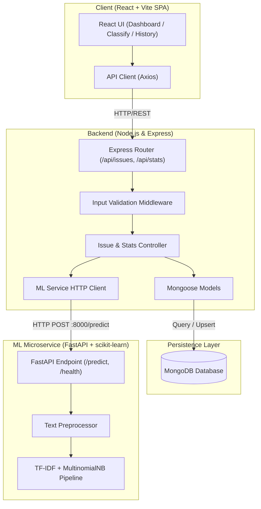
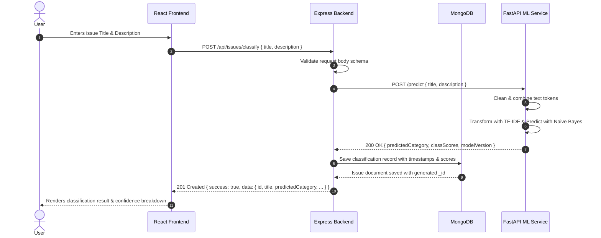

# DevAssist System Architecture

## Overview
DevAssist is an end-to-end intelligent GitHub issue classification system structured into three decoupled layers:
1. **Frontend (Client)**: Modern React SPA built with Vite, React Router, Recharts, and accessible semantic components styled with a custom dark theme.
2. **Backend (Server)**: Node.js Express REST API managing validation, MongoDB persistence, statistics aggregations, and orchestrating requests to the Machine Learning microservice.
3. **Machine Learning Service (ML Service)**: Python FastAPI service serving a trained Natural Language Processing pipeline (TF-IDF vectorizer + Multinomial Naive Bayes).

---

## Architectural Diagram

---

## Request Flow Sequence

---

## Security & Reliability Design
- **Downstream Resiliency**: Node.js implements timeout protection and handles connection failures gracefully if the ML service is unreachable (returning 503 Service Unavailable).
- **Rate Limiting**: Express middleware applies granular rate limits on classification actions to protect prediction endpoints against burst abuse.
- **Input Sanitization**: Multi-layer validation via Pydantic on the ML service and `express-validator` on the Express API.
- **Data Isolation**: Database credentials, service URLs, and port bindings are completely managed via `.env` files with version-controlled `.env.example` templates.
